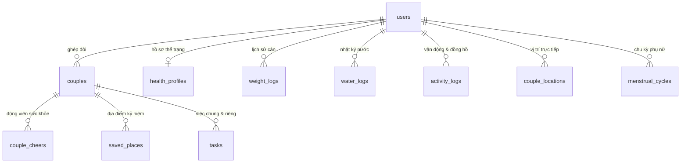

# 🗄️ HỆ THỐNG CƠ SỞ DỮ LIỆU SUPABASE - COUPLE SCHEDULE

Thư mục này chứa toàn bộ kiến trúc Database và các file Migration SQL của ứng dụng **Couple Schedule**.  
Khi thiết lập một dự án Supabase mới hoặc cập nhật môi trường, hãy chạy các file SQL theo thứ tự đánh số bên dưới trong mục **SQL Editor** trên trang quản trị Supabase.

---

## 📂 Danh Sách Migration SQL (Chạy theo thứ tự)

| Thứ tự | File Migration | Mô tả chi tiết chức năng |
| :--- | :--- | :--- |
| **01** | [`01_initial_schema.sql`](./migrations/01_initial_schema.sql) | **Bảng cốt lõi**: `users`, `couples`, `tasks`, `love_diaries`, `special_dates`, `memories` |
| **02** | [`02_menstrual_cycle.sql`](./migrations/02_menstrual_cycle.sql) | **Chu kỳ & Chăm sóc**: `health_profiles`, `menstrual_cycles`, `symptoms_log`, Trigger `updated_at` |
| **03** | [`03_couple_health_wellness.sql`](./migrations/03_couple_health_wellness.sql) | **Hệ sinh thái sức khỏe**: Mở rộng `health_profiles` (chiều cao, cân nặng, mục tiêu), `water_logs`, `weight_logs`, `activity_logs`, `couple_cheers` |
| **04** | [`04_couple_live_location.sql`](./migrations/04_couple_live_location.sql) | **Couple Live Map**: `couple_locations` (tọa độ GPS, pin, tốc độ), `saved_places` (địa điểm đôi), `places_visited` |
| **05** | [`05_task_logs.sql`](./migrations/05_task_logs.sql) | **Lịch sử công việc**: `task_action_logs` ghi nhận lịch sử hoàn thành / chỉnh sửa công việc |
| **06** | [`06_seed_weekly_tasks.sql`](./migrations/06_seed_weekly_tasks.sql) | **Dữ liệu mẫu**: Bộ công việc tuần & thói quen chăm sóc đôi lứa mẫu |
| **07** | [`07_health_prescription_customization.sql`](./migrations/07_health_prescription_customization.sql) | **Phác đồ thể trạng cá nhân hóa**: Thêm `target_date`, `daily_calorie_target`, `daily_step_goal`, `preferred_workout_style` vào `health_profiles` |
| **08** | [`08_couple_love_counter_and_special_dates.sql`](./migrations/08_couple_love_counter_and_special_dates.sql) | **Đếm ngày yêu & D-Day**: Thêm `start_date`, `sticky_notification_enabled`, `sticky_notification_format` vào `couples`, tạo bảng `couple_special_dates` |

---

## 🏛️ Sơ Đồ Kiến Trúc Thực Thể (Entity Relationships)

---

## 🚀 Hướng Dẫn Chạy Migration

1. Đăng nhập vào [Supabase Dashboard](https://supabase.com/dashboard).
2. Chọn Project của bạn -> Vào menu **SQL Editor** ở thanh điều hướng bên trái.
3. Mở file migration cần chạy (hoặc copy toàn bộ nội dung file `.sql`).
4. Dán vào khung SQL Editor và nhấn **RUN** (Ctrl + Enter).
5. Sau khi chạy thành công, kiểm tra lại trong **Table Editor** và mục **Database -> Publications** để đảm bảo tính năng **Realtime** đã được kích hoạt.
